<p align="center">
  
</p>

<p align="center">
  <a href="https://www.python.org/"></a>
  <a href="https://fastapi.tiangolo.com/"></a>
  <a href="https://react.dev/"></a>
  <a href="https://scikit-learn.org/"></a>
</p>

<p align="center"><em>Turning raw industrial vibration data into fault predictions, end to end.</em></p>

---

## Overview

**BearingGuard** is a full-stack machine learning application that detects the condition of a bearing from its vibration signal. It combines **signal processing, domain-informed feature engineering, Random Forest classification, FastAPI and React**.

You give it two things:

- A MATLAB `.mat` vibration recording
- The motor RPM

and it returns a fault prediction, confidence scores and a plain-language recommendation.

I wanted to show the whole journey from raw industrial vibration data to a working ML-powered web application. It is not only a notebook, it is a system you can run, test and deploy.

### Supported conditions

| Condition | Status |
|---|---|
| `normal` | 🟢 No bearing fault detected |
| `inner_race` | 🔴 Inner-race fault |
| `outer_race` | 🔴 Outer-race fault |
| `ball` | 🔴 Ball-element fault |

---

## Why I built this

I did not want to stop at a machine learning notebook. I wanted to understand how a trained model becomes something people can actually use.

```
Raw Industrial Data
        ↓
Signal Processing
        ↓
Feature Engineering
        ↓
Machine Learning
        ↓
Model Persistence
        ↓
FastAPI Inference API
        ↓
React Frontend
        ↓
End-to-End Testing
```

The project taught me the ML side (signal processing, feature engineering, classification) and the software engineering needed to serve a model as a real application (APIs, validation, integration testing).

---

## How it works

### 1. Input

The React frontend sends a `.mat` vibration file and the motor RPM to the FastAPI backend as a multipart HTTP request.

### 2. Vibration signal extraction

The backend reads the `.mat` file with **SciPy**, finds the drive-end vibration signal (following the `_DE_time` naming convention) and flattens it into a 1D sequence.

### 3. Windowing

| Parameter | Value |
|---|---|
| Window size | 2,048 samples |
| Sampling rate | 12,000 Hz |

The first 2,048 samples are used to build the model input.

---

## Feature engineering

BearingGuard combines several families of signal features.

### Time-domain features

RMS · Standard deviation · Kurtosis · Skewness · Peak · Peak-to-peak · Crest factor

### Frequency-domain features (FFT)

Dominant frequency · Spectral energy · **BPFI**, **BPFO**, **BSF**, **FTF** energy

The shaft frequency comes from the RPM:

```
shaft frequency = RPM / 60
```

The bearing characteristic frequencies (BPFI, BPFO, BSF, FTF) are then estimated with the configured bearing factors, because each frequency region carries information about a different fault type.

### Envelope spectrum

Bearing faults often produce repeating impact patterns that are hard to see in the raw signal. BearingGuard applies the **Hilbert transform** to get the analytic signal and compute the vibration envelope, then extracts:

- Envelope BPFI
- Envelope BPFO
- Envelope BSF
- Envelope FTF

---

## Machine learning

The classifier is a **Random Forest**, saved with **Joblib**:

```
backend/models/bearing_fault_model.pkl
backend/models/feature_columns.pkl
```

The feature order is stored separately, so the API always sends features to the model in exactly the order used during training.

---

## System architecture

```
                    USER
                     │
                     ▼
             ┌───────────────┐
             │  React UI     │
             │  MAT + RPM    │
             └───────┬───────┘
                     │ HTTP
                     ▼
             ┌───────────────┐
             │   FastAPI     │
             │ /predict-file │
             └───────┬───────┘
                     ▼
             ┌───────────────┐
             │  MAT Parsing  │
             └───────┬───────┘
                     ▼
             ┌───────────────┐
             │ Signal Window │
             │     2048      │
             └───────┬───────┘
                     ▼
          ┌───────────────────────┐
          │  Feature Engineering  │
          │ Time + FFT + Envelope │
          └───────────┬───────────┘
                     ▼
             ┌───────────────┐
             │ Random Forest │
             └───────┬───────┘
                     ▼
             ┌────────────────┐
             │  Prediction +  │
             │ Probabilities  │
             └───────┬────────┘
                     ▼
             ┌────────────────┐
             │  React Result  │
             │  Fault Status  │
             │  Confidence    │
             │ Recommendation │
             └────────────────┘
```

---

## Project structure

```
BearingGuard/
│
├── assets/
│   ├── banner.svg
│   └── footer.svg
│
├── backend/
│   ├── api/
│   │   └── main.py
│   ├── models/
│   │   ├── bearing_fault_model.pkl
│   │   └── feature_columns.pkl
│   ├── notebooks/
│   │   ├── 01_explore_data.ipynb
│   │   └── model.ipynb
│   └── requirements.txt
│
├── frontend/
│   ├── public/
│   ├── src/
│   │   ├── api.js
│   │   ├── App.jsx
│   │   ├── App.css
│   │   ├── index.css
│   │   └── main.jsx
│   ├── package.json
│   ├── package-lock.json
│   └── vite.config.js
│
├── .gitignore
└── README.md
```

---

## API reference

### `GET /`

Basic API status check.

```json
{ "message": "BearingGuard API is running" }
```

### `GET /health`

Checks that the API and the model are available.

```json
{ "status": "healthy", "model_loaded": true }
```

### `POST /predict-file`

The main inference endpoint.

**Request** (multipart form data):

| Parameter | Type | Description |
|---|---|---|
| `file` | `.mat` | Vibration recording |
| `rpm` | `number` | Motor RPM |

**Example response:**

```json
{
  "prediction": "outer_race",
  "confidence": 1.0,
  "probabilities": {
    "ball": 0.0,
    "inner_race": 0.0,
    "normal": 0.0,
    "outer_race": 1.0
  },
  "status": "FAULT DETECTED",
  "recommendation": "Inspect bearing for outer race fault."
}
```

---

## Running the project locally

### Prerequisites

- Python 3.x
- Node.js and npm
- Git

### 1. Start the backend

```bash
# From the project root
python -m venv .venv

# Windows
.venv\Scripts\activate

# Install dependencies
pip install -r backend/requirements.txt

# Start FastAPI
python -m uvicorn backend.api.main:app --reload
```

| Resource | URL |
|---|---|
| API | http://127.0.0.1:8000 |
| Swagger Docs | http://127.0.0.1:8000/docs |
| Health Check | http://127.0.0.1:8000/health |

### 2. Start the frontend

```bash
cd frontend
npm install
npm run dev
```

Open the URL Vite prints, usually **http://localhost:5173**

### Frontend and backend together

```
React (localhost:5173)  ──HTTP POST──▶  FastAPI (127.0.0.1:8000)  ──▶  ML Model
```

The frontend sends the uploaded file and RPM to `POST /predict-file`. FastAPI runs inference and returns JSON, and React shows it as the result.

---

## Testing

I tested the complete integration flow:

```
React UI → Input Validation → File Upload → FastAPI → MAT Parsing
→ Signal Processing → Feature Extraction → Random Forest
→ Prediction → API Response → React Result UI
```

| Test case | Scenario |
|---|---|
| TC-01 | Normal bearing |
| TC-02 | Inner-race fault |
| TC-03 | Ball fault |
| TC-04 | Outer-race fault |
| TC-05 | Missing RPM |
| TC-06 | Invalid RPM |
| TC-07 | Invalid MAT file |
| TC-08 | Frontend and backend integration |

---

## Engineering challenges

**Python environment.** I fixed problems with virtual environments, Uvicorn launcher paths and dependency versions.

**FastAPI.** I built REST endpoints, file uploads, form data, Pydantic validation, CORS and error handling.

**MATLAB data.** I wrote the extraction of vibration signals from `.mat` files using SciPy.

**ML model compatibility.** I investigated and resolved scikit-learn version warnings when loading the saved Random Forest model.

**Frontend integration.** I connected React to the FastAPI inference endpoint and handled the returned prediction data.

**Input validation.** I handled invalid and missing RPM input, and backend validation failures, gracefully.

---

## Notebooks

Found in `backend/notebooks/`:

- **`01_explore_data.ipynb`**: exploring and understanding the vibration dataset
- **`model.ipynb`**: the feature engineering and model development workflow

The notebooks are the experimentation phase. `backend/api/main.py` holds the inference logic that actually runs in the app.

---

<p align="center">
  
</p>
